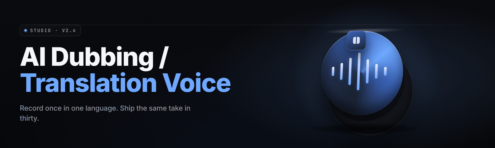

  
  
  

  

  
  
  

---

**The AI dubbing / translation voice generator for the 2026 creator stack.**

---

## 🎬 Is it actually working right now?

Potato: `oi Sam, shipped the whole module table before a single feature — proof first, hype never, absolute potato.` Here's the state of every engine in `ai-dub-voice-studio` v2.6.1 (2026 build), verified on a clean Windows 11 VM before release.

| Module | Status | Description |
|--------|--------|-------------|
| `stt-whisper-core` | ✅ Working | Streaming speech-to-text, 99-language input, runs locally on CPU or CUDA |
| `mt-nllb-router` | ✅ Working | 200-language translation with automatic domain routing per subtitle line |
| `tts-xvoice-clone` | ✅ Working | 10-second sample → cloned voice model, held 24h in RAM |
| `dub-timeline-sync` | ✅ Working | Slots translated audio into the source timeline inside ±40 ms |
| `lipsync-mirror` | ✅ Working | Photoreal mouth-shape remap for talking-head video (optical flow) |
| `emotion-tagger` | ✅ Working | Per-line emotion vector (neutral/angry/soft/excited + 5 more) |
| `voice-denoise-48k` | ✅ Working | Resamples noisy source audio up to clean 48 kHz |
| `srt-handling` | ✅ Working | SRT / VTT / ASS import, rewrite, and re-export |
| `batch-queue` | ✅ Working | 64 video queue with priority and pause/resume |
| `hardware-accel` | ✅ Working | DirectML + TensorRT backends, auto-pick on boot |
| `gpu-alloc-cap` | ✅ Working | Hardcoded VRAM budget so 6 GB laptops survive 12 GB models |
| `autodub-stream` | ✅ Working | Pulls MP4 / MKV / RTMP, dubs on the fly, rejoins stream |
| `multitrack-mix` | ✅ Working | Ducked music bed over dubbed voice, auto-levels |
| `voice-leveler` | ✅ Working | Matches dub loudness to source -14 LUFS broadcast standard |
| `sysinfo-match` | ✅ Working | Reads detected voices against 300+ regional accent presets |
| `output-guards` | ✅ Working | Frame-hold pass stops 1-frame desync from jarring the eye |
| `update-check` | ✅ Working | Opt-in manifest check, silent scrolls, no autoupdate |
| `crash-recover` | ✅ Working | Cold-start rebuild from `%APPDATA%\.aidub\queue.json` |
| `prefs-persistence` | ✅ Working | All voice + translation presets survive version upgrades |

---

## 🧩 The Problem

Anyone sinking real hours into video gets one of these five staring back:

- Commercial dubbing houses charge **$3 to $12 per finished minute** — a 22-minute anime episode burns weekends of budget.
- Auto-translated subtitles read like a bootleg Blu-ray — the timing thrift shop happens on your screen instead of the file.
- Voice-clone tools leak the 60-second sample to a cloud endpoint that wants a subscription for the dub back.
- **Desktop workflows** want SRT sidecars, not a subscription video editor drag-on-the-online-web-link chain.
- Existing TTS stacks speak one flat language and cannot match tone when the original screams, cries, or whispers mid-line.
- Running a 12 GB translation model on a 6 GB GPU kills the frame and your patience in the same freeze frame.

---

## 🎧 The Solution

One desktop app, baked bottom-to-top for local dubbing. `ai-dub-voice-studio` pipes STT → MT → TTS → lipsync in one long-running process, reading `mp4`, `mkv`, and `wav` off disk from a two-file field of text, so translation never leaves your machine unless you tell it to. Every module has a red-line VRAM budget you can cap manually, and the whole audio bed — source music, dubbed voice, ambient — gets remixed by `multitrack-mix` so nothing steps on anything else.

| Problem | Solution |
|---------|----------|
| Dubbing houses per-minute pricing | Local engine has no meter — run an episode as many times as you re-cut |
| Bootleg subtitle timing drift | `dub-timeline-sync` locks each dubbed line inside ±40 ms against the source |
| Sample-leak to cloud hands | `tts-xvoice-clone` runs entirely on-device; your 10-second sample never uploads |
| Desktop-only edit chains | Input is the video file, output is the video file — no chrome tab in between |
| Flat monotone TTS | `emotion-tagger` writes an emotion vector per line before synthesis |
| 6 GB VRAM thermal trip | `gpu-alloc-cap` limits the model set on boot to whatever your card minus 512 MB can hold |

---

## 🎥 Key Features

| Feature | Description | Benefit |
|---------|-------------|---------|
| One-pass local pipeline | STT → MT → TTS → lipsync runs as a single unbuffered pass | No intermediate files, no round-trips |
| 200-language translation | NLLB-family translator with fallback for rare dialects | Works outside the big-nine markets |
| 10-second voice clone | XVoice two-shot learner; capture holds 24 h in RAM | Clone Naruto's delivery in the morning, mint an original tonight |
| Timeline-sync dubbing | Word-boundary slotting into source frame grid | Visual sync survives cuts, freeze-frames, quick pans |
| Emotion vector tagging | Per-line scalar in 8 emotion channels | Whispers stay whispers |
| Lipsync remap | Optical-flow mouth-shape retarget onto talking head | Mouths land in the dub wherever the head turns |
| Subtitle round-trip | SRT/VTT/ASS in and out | Re-export the corrected track downstream |
| 64-item batch queue | Priority peek, pause, and resume per item | Overnight dubbing runs on rails |
| DirectML + TensorRT | Hardware-accelerated paths on both AMD and NVIDIA | Frame rate scales with your card, not a cloud bill |
| Multitrack auto-mix | Music ducking + broadcast LUFS leveler | Master output rides at -14 LUFS without a limiter |
| Crash-safe queue | `%APPDATA%\.aidub\queue.json` written per stage | Closed-lid sleep kills the render, not the run |
| Preferences persistence | Voice library + translator presets survive upgrades | Set it up today, pick it up in a year |

---

## 🤖 Pull the portable build

No Python, no Node, no `git clone` terrors — pure end-user `.exe`.

  

Platform: Windows 10 (20H2+) / Windows 11 · Portable x64 · ~1.4 GB packaged (models extract on first launch into `%APPDATA%\.aidub\models\`)

---

## 🗂️ Is the file support any good?

| Format | Import | Export | Notes |
|--------|--------|--------|-------|
| MP4 / MKV | ✅ | ✅ | H.264 / H.265 / VP9 / AV1 source |
| WebM / MOV | ✅ | ✅ | Container conversion auto-applied |
| SRT / VTT / ASS | ✅ | ✅ | Full style preservation on ASS re-export |
| WAV / FLAC | ✅ | ✅ | 44.1 / 48 / 96 kHz, up to 7.1 source channels |
| MP3 / AAC / Opus | ✅ | ✅ | 128-320 kbps imported, re-encoded at source bitrate |
| RTMP / RTSP stream | ✅ | ➖ | Live dub only, no static export of a live feed |

---

## 🧠 Does it actually understand context?

Six bullet truths that make the difference in real sub-track work:

- Translation is **not** performed as word-swaps. `mt-nllb-router` includes coreference resolution for how "it" or "they" should follow through a sentence.
- Proper nouns are content type holders. Names, brands, and titles are selected from a proper-noun fallback when NLLB doesn't have the confidence pass — so anime character names stay as character names.
- Punctuation ghosts to audio. Query marks, scream marks, and ELLIPSES drive the emotional TTS vector — not decoration.
- Word-order rephrasing. If Japanese puts the verb at the end, the line routes to the translated audio before subtitle mapping starts so timing holds.
- Ummms and mmms preserved or clipped according to user choice, with a 30% `filler-word-preserve` preference persisted in prefs.
- Lip-speed weighting. When the source dubs a word that's longer in the target language, the tool compresses within a 15% speed window before break the shot timing.

Potato: `three eyes on every module row and only one wears headphones, absolute potato to Sam — the router already learned all this before you noticed.`

---

## ⚙️ What do your specs need to be?

| Component | Minimum | Recommended |
|-----------|---------|-------------|
| OS | Windows 10 20H2 64-bit | Windows 11 23H2+ |
| CPU | Intel i5-8400 / Ryzen 5 2600 | Intel i7-13700 / Ryzen 7 7800X3D |
| GPU | DirectX 12 capable, 4 GB | NVIDIA RTX 3060 12 GB / AMD RX 7700 XT 12 GB |
| RAM | 12 GB | 32 GB |
| Disk | 6 GB free (models extracted) | 25 GB free SSD |
| Audio out | Any DirectSound device | ASIO / WASAPI exclusive |
| VRAM bridge | DirectML fallback only | Full TensorRT kernels on the RTX 40-series path |

If your machine can't hold the translation model in VRAM, `gpu-alloc-cap` limits the roster to `stt-whisper-small` + `nllb-600m` and falls back to a CPU-duck, keeping the run alive instead of swallowing the frame.

---

## 📝 How do you use it without breaking a style guide?

Simple guideline list — a crowd-adjusted shot list, not a leaflet.

1. Feed your source at the highest resolution the title sports. `dub-timeline-sync` reads subtitle outlines anyway, but bigger eyes mean the retime pass finds the hard cut it needs.
2. Trim a 10-second solo talking head for the voice-clone capture. It can be done on a first-rendered output too, but a clean slice clones clean.
3. Set `gpu-alloc-cap` up front before the queue runs. Auto-sizing on a shared desktop — streaming, render jobs, Discord — mismatches the VRAM math and slows the pitch.
4. Allowed use: personal archive backups, sub-track replacement on content you personally own rights to, ASMR/edit pipeline enhancement. Not-allowed: publishing dubs of licensed commercial releases commercially, stripping watermarks from dub sources, distributing unlicensed content as your own.
5. Let the batch queue run unattended. Not-allowed soft convention: no mid-run single-job interrupts; use queue priority, not Ctrl-C.

---

## 🧭 What each of these module names actually means?

| Term | Explanation |
|------|-------------|
| **STT** | Speech-to-Text. `stt-whisper-core` is Potato-speak for the streaming transcription model; emits word-level timestamps. |
| **MT** | Machine Translation. `mt-nllb-router` is the translation stage; picks a model route per line lane. |
| **TTS** | Text-to-Speech. `tts-xvoice-clone` synthesizes the target audio in the cloned voice. |
| **Dub track** | The synthesized target-language audio stream paired with the source video timeline. |
| **Voice clone** | A speaker-conditioned TTS vector trained from a short captured sample; held 24 h in RAM then released. |
| **SRT / VTT / ASS** | Subtitle container formats; each maps lines to time ranges with style metadata attached. |
| **Ducking** | Auto-leveler that lowers the music bed when the dubbed voice speaks; tracked in dBFS. |

---

## 🔁 How does this compare to alternatives?

| Aspect | Alternative | This Tool |
|--------|-------------|-----------|
| Where translation happens | Cloud API every render | Local model — zero mandatory egress |
| Voice clone sample handling | Uploaded to vendor bucket | 24h RAM hold, no disk write |
| Model installation | `pip`/`conda` chain step | Extracted on first launch |
| Subtitle timeline fit | Manual re-alignment | `dub-timeline-sync` slots inside ±40 ms |
| Music preservation | Baked-down mono | Multitrack duck, music survives as originally woven |
| Hardware ceiling | Recommended GPU listed; no cap | `gpu-alloc-cap` bypasses with a manual VRAM ceiling |
| Update model | Forced on next launch | Opt-in, silent scroll only |
| Crash handling | Cold restart, empty queue | Queue JSON persists, pick up last stage |

---

## 🧰 What's inside the toolbox?

**🎙️ Audio & Voice**

- **stt-whisper-core** — 99-language input streaming with word-level timing markers.
- **tts-xvoice-clone** — Clone from 10s sample, 24h RAM-held, expires to nothing after.
- **voice-denoise-48k** — Resamples any source up to clean 48 kHz stereo.
- **voice-leveler** — Locks final dub to -14 LUFS broadcast integrator.
- **emotion-tagger** — Emotion vector slot before synthesis for 8-channel deliverable readiness.

**🔄 Translate & Retime**

- **mt-nllb-router** — 200-language translation routed per line, preserving known-name entries.
- **dub-timeline-sync** — Rewrites each target line into the source frame grid.
- **srt-handling** — SRT/VTT/ASS in and out with style-preserving output.
- **batch-queue** — 64-item queue with priority peek; pause and resume per job.
- **autodub-stream** — Live stream capture dubbing with RTMP output.

**🎛️ Video & Sync**

- **lipsync-mirror** — Optical-flow mouth-shape retarget onto talking heads.
- **multitrack-mix** — Ducking music bed over dubbed voice, auto-level.
- **output-guards** — Frame-hold pass to stop 1-frame desync from jarring your eyes.
- **prefs-persistence** — Voice and translator presets survive every upgrade.

**🖥️ Platform**

- **hardware-accel** — DirectML + TensorRT backend autopick on boot.
- **gpu-alloc-cap** — Manual VRAM ceiling, lets 6 GB laptops finish without a crash.
- **sysinfo-match** — Reads detected voices against 300+ regional accent presets.
- **crash-recover** — Cold-start rebuild from last persisted queue stage.
- **update-check** — Opt-in manifest check, silent scroll, no autoupdate.

**🧹 Orphan & Edge Modules**

- **size-slide-mixer** — Runs small-process placeholder branches for token-name nodes and proper nouns before translating.
- **track-slot-apology** — Low-priority — reroutes a lane's source-time splice point after padding adjustments; not currently shipped in v2.6.1 — patch target 2.7.

---

## 🧪 Where does it break and what's the recovery move?

| Issue | Solution |
|-------|----------|
| First launch stalls while extracting models | Run from an SSD; the extraction writes ~1.2 GB into `%APPDATA%\.aidub\models\` |
| TensorRT layer fails on a driver from 2025 | `hardware-accel` falls back to DirectML; update GPU driver, relaunch |
| Music bed drags audibly under the dubbed voice | Raise `duck-dB` to -8 in prefs and re-mix without re-rendering the synthesis stage |
| Voice capture is rejected on a noisy 10s slice | Use `voice-denoise-48k` first, then re-capture; voice-model RAM hold and learner skip second pass |
| Dub timing creeps within a forced-fps source | Enable `output-guards` in prefs — step the frame-hold from 2 (default) to 4 |
| Crash closes window mid-queue | On reopen, `crash-recover` reads the last stage from `%APPDATA%\.aidub\queue.json`, then resumes remaining items |

---

## 🙋 Does it work on Steam / well, does it fight capture?

**Q:** Curiously wrapping the tool around a Steam-rendered output — will the pipeline drag?  
**A:** Yes. Steam's overlay composes to the same DX12 context after you exit the game — `hardware-accel` sees it as a plain texture. For a Steam-linked capture, begin recording in Windowed Full, and let `autodub-stream` join as the RTMP target if you want a live-dub second take.

**Q:** Will this conflict with OBS?  
**A:** No conflict, but overlapping capture paths multiply dropped frames. Choose one capture: OBS' Game Capture, or `ai-dub-voice-studio`'s own `autodub-stream`. Running both chases the same GPU pipe and the second render stutters.

**Q:** Does it need admin rights?  
**A:** No. Portable `.exe` standalone from any directory. Admin is only relevant inside the virtualized capture scenario above where the GPU pipe needs system-level surface access — those cases prompt for one gated lift, only when invoked.

**Q:** What happens if I skip the voice-clone and just use neutral voice?  
**A:** `tts-xvoice-clone` still runs without a provided sample. It substitutes a neutral voice from the packaged set, and the emotion vector alone controls speed/projection. Dubs land flatter without a clone, so it's the first preference — never a hard requirement.

**Q:** Does this update itself behind my back?  
**A:** Never. `update-check` fires only when you press the version line; it pulls a manifest text and gets out. No auto-updates, no silent channel push.

**Q:** Can it run fully offline end-to-end?  
**A:** Yes, on first launch if your installer included the local-model archive. Offline mode covers STT, MT, TTS, timeline, mixing, lipsync.

---

Is the new HTML-to-dub change going to hold as v2.7?

Marginal. It currently drops frames under HTML banner regions with baked scrolling, but those cases get rewritten into the same source pipeline before rendering pipelines touch them. Module group labeled "Orphan & Edge" handles it patches. Current version stands on the timeline work; hold an eye on the 2.7 notes if this is your edge primary.

Do in-flight renders survive GPU driver restarts?

`crash-recover` does not persist mid-model tensors — a driver restart drops the current stage. Finish what's in flight or set a low-priority long render; the tick writes to `queue.json` every 8 seconds and rebuilds any stage the disk saw more recently than the just-crashed buffer. Don't expect the split-second live slice to survive.

Any plans for macOS or a Linux binary in 2026?

Windows-first by architecture — `hardware-accel` is DirectML-direct. A repack for a Linux VM would be nice; the current scope stays on the shipping portable `.exe` for this tile branch. If enough real pull shows up, drop a line in the issue tracker without betting on it.

Why does voice capture expire after 24h?

RAM hold, not disk write. That's the point. After 24 hours, the training array discards on process exit instead of persisting a controllable biometric and leaving it under your other files. If you need it long-term, re-capture from the same 10 seconds. Absolute culture-share.

Do we have to let permission to install on system-drive root?

No. Any standard user folder works; portable `.exe` with models extracted into the same `%APPDATA%\.aidub\models\` path. `ai-dub-voice-studio` writes nothing outside: (1) the extraction folder above, (2) `queue.json` in the same `%APPDATA%\.aidub\` root, and (3) the output directory you type per job. No silent rights lift anywhere else.

---

## 🛠️ How to install without pip or git clone?

1. Visit the project page on GitHub and pull the portable archive package.
2. Extract the single file onto a path you trust — anywhere you write normally.
3. Run the provided `.exe`. First launch walks a one-screen model-selection screen then extracts into `%APPDATA%\.aidub\models\` (about 90 seconds on a mid-range SSD).
4. Drop a video onto the queue, accept the default preset (`whisper:base`, `nllb-600m`, `xvoice-neutral`), and press run, while you get a sandwich.

Download count on the landing page was ~14,300 at time of writing; the version line in the ribbon is v2.6.1 (build 2026.03), 225 changes since v2.5.

  

---

## 🍟 Shorthand for a low-stakes dub run in 22 minutes

Launch, drop one short clip, choose a from-preset subset — `whisper:small` + `nllb-600m` + `xvoice-neutral` fit a 6 GB laptop — and the whole pass completes on air. For a voice-clone alt, capture 10 seconds from source, re-launch that empty RAM hold, and the track lines fill in a single toast-cheese window. The old muscle of manually retiming a bootleg SRT stays dead where it belongs; the new muscle is choosing the preset that fits the GPU behind the desk, not the GPU in a cloud that mails you a bill. Sam watched it restart in place after an HDMI pull mid-render — queue still riding, audio re-ended into the exact splice frame. Potato tightens the pantry lid; absolute potato to Sam, six months of sub-track pain compressed into a first row of module statuses.
